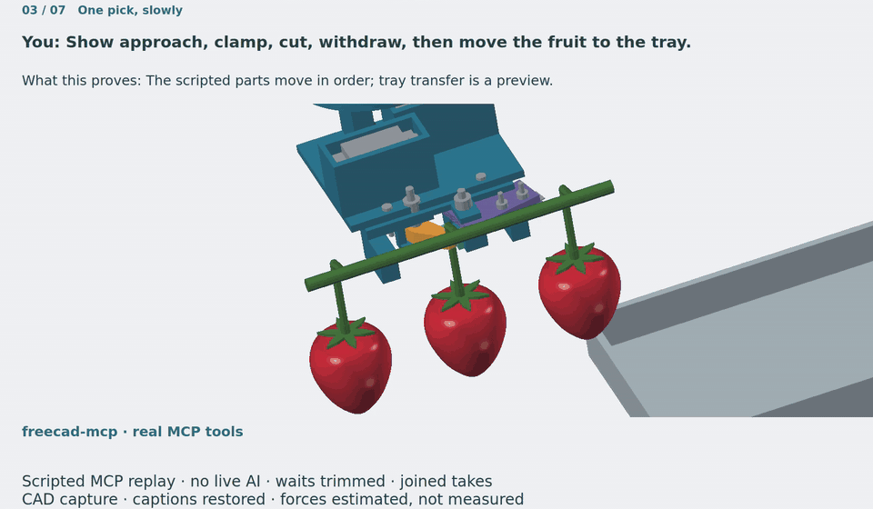
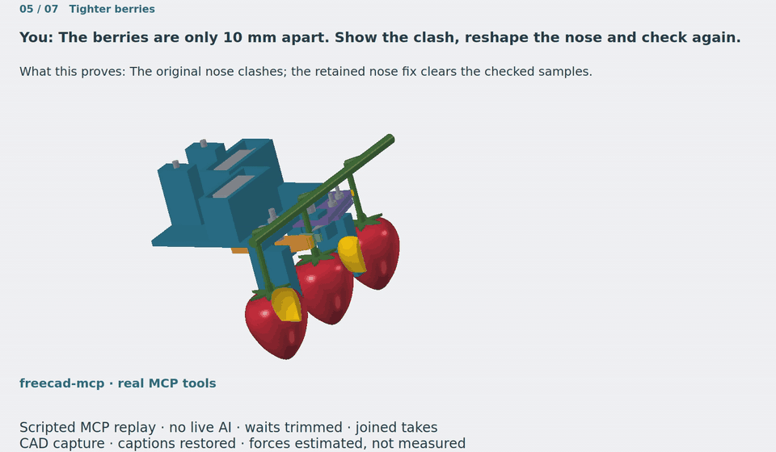
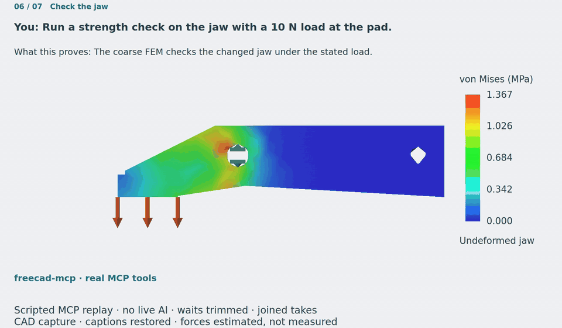

# FreeCAD MCP

Let an AI assistant design, check and export real parametric FreeCAD models through
MCP, the protocol that connects assistants to tools. Change a dimension and the
linked features update. FreeCAD itself builds the geometry, measures it and
verifies the result.


A small head holds a strawberry stem, cuts above the pad and withdraws the fruit.<br>
A tight cluster reveals a clash; a shorter nose clears the checked samples.<br>
Force estimates, a jaw strength check and print files prepare the next bench test.

[See the seven demo chapters, evidence and limits](#the-strawberry-picker-demo).

## What it can do

These are example requests for a connected assistant. Each combines several tools;
the assistant chooses the calls and reads their results.

### Model parts with sketches and constraints

Build editable parts from outlines, dimensions, holes, rounded edges and patterns.

> Make a mounting plate 60 × 40 × 5 mm, with four mounting holes and rounded edges.

**Comes back:** a FreeCAD Body with sketches, constraints and a feature history,
plus sketch diagnostics and solid validation.
**Tools:** `body_create`, `sketch_create`, `sketch_add_rectangle`, `sketch_add_circle`,
`sketch_add_constraint`, `get_sketch_diagnostics`, `pad_feature`, `pocket_feature`,
`fillet_feature`, `validate_geometry`.

<details>
<summary>Drawing and toy-car modelling examples</summary>


</details>

### Change dimensions from a spreadsheet

Link dimensions to named spreadsheet cells so one edit updates related features.

> Put the plate width and hole spacing in a spreadsheet, then make the plate wider.

**Comes back:** cell values, named parameters and expression bindings that remain
in the editable model.
**Tools:** `spreadsheet_create`, `spreadsheet_set_cells`, `spreadsheet_set_alias`,
`set_expression`, `spreadsheet_get_cells`, `list_expressions`, `recompute_document`.



The picker's pick motion is a series of spreadsheet poses. It is a scripted
preview, not a solved assembly or a dynamics simulation.

### Assemble parts and connect joints

Group components, fix a base in place and connect moving parts with joints.

> Ground the bracket and connect the lever to its pivot with a revolute joint.

**Comes back:** assembly components, a grounded joint, a revolute joint and solver
status; an unsatisfied solve returns an error.
**Tools:** `create_assembly`, `move_object`, `create_assembly_grounded_joint`,
`create_assembly_joint`, `solve_assembly`.

### Measure fit, clearance and estimated mass

Measure gaps and overlaps, and use model volumes with material inputs to estimate mass.

> Check the head against neighbouring fruit at these poses, then estimate its mass.

**Comes back:** distances, volumes, centres of mass and overlap flags for each
sampled pose; a calculated mass depends on the supplied densities and fill assumptions.
Sampled clearance does not prove a collision-free continuous path.
**Tools:** `measure_distance`, `measure_volume`, `bounding_box`, `center_of_mass`,
`common_volume_along_path`, `spreadsheet_get_cells`, `execute_code`.



### Check strength with FEM

Use finite element analysis (FEM) to estimate stress and bending under a stated load.

> Fix the jaw at its pivot bore and check a 10 N load on the pad backing.

**Comes back:** maximum von Mises stress, displacement, node count and solver files,
or a setup or solver error. The analysis needs geometry, material, mesh, supports,
a load and an available CalculiX solver; see the [setup example](examples/cantilever_fem.py).
**Tools:** `create_object`, `run_fem_analysis`, `execute_code`.



### Catch edits that look successful but failed

Check for empty features, cuts that removed no material, broken expressions and misplaced references.

> This pocket says it is up to date, but the hole is missing. Find what went wrong.

**Comes back:** feature direction and geometry diagnostics, recompute errors and
shape validity. Feature checks reject zero material change and the wrong sign of
material change; see the [regression tests](tests/test_feature_material_delta.py).
**Tools:** `diagnose_pocket`, `get_recompute_log`, `diagnose_parametric`,
`preview_attachment`, `placement_audit`, `validate_geometry`, `pad_feature`, `pocket_feature`.

### Inspect, import and export models

Show the model from useful angles, bring in existing parts and write files for CAD or printing.

> Import the wrist STEP, show the head beside it, then export the head as STEP and STL.

**Comes back:** imported objects, viewport images or view-sequence frames, and
exported files. STEP and BREP import and export are available; STL is an export tool.
Native FreeCAD projects can also be opened and saved.
**Tools:** `import_step`, `import_brep`, `get_view`, `save_view_sequence`, `set_color`,
`export_step`, `export_brep`, `export_stl`, `open_document`, `save_document`.


### Keep checkpoints and coordinate assistants

Save a checkpoint before an experiment, undo edits and use document leases to coordinate writers.

> Take a snapshot before changing the jaw. Keep this document leased until it is checked and saved.

**Comes back:** a snapshot ID, restore or undo results, lease ownership and final
save/validation status. Leases coordinate cooperative MCP writers; they do not
sandbox Python or macros. Document rollback does not undo exported files.
**Tools:** `snapshot`, `restore`, `undo`, `redo`, `acquire_document_lock`,
`get_document_lock`, `finalize_document_edit`.

### Work remotely and run checks without a window

Connect to FreeCAD on another machine and run read-only checks in a separate headless FreeCADCmd process.

> On my remote workstation, check these poses in the read-only worker and report overlaps.

**Comes back:** runtime identity, worker availability and analysis results from a
snapshot of the model. The live document is not changed by worker analysis.
Viewport capture needs a GUI; remote setup is in [Advanced](#advanced).
**Tools:** `get_runtime_info`, `get_worker_status`, `execute_code`,
`common_volume_along_path`, `cancel_worker_job`.

## The strawberry picker demo

The head has ten printed parts, two servo drives and a replaceable 39 mm blade.
The retained native model includes the wrist reference, fruit cluster and tray.
Results below are rounded from the retained evidence.

| Chapter | What happens | Retained result |
| --- | --- | --- |
| 1. Build from a spreadsheet | Regenerate the saved parametric design. | 530 dimension expression readbacks; 0 empty bindings. |
| 2. Enough force? | Compare calculated force with 10 N grip and 15 N cut targets. | Minimum clamp 23.138 N; cut 33.417 N. |
| 3. One pick, slowly | Approach, clamp, cut, withdraw and move toward the tray. | Spreadsheet-driven poses; tray transfer is an unvalidated placement preview. |
| 4. Check the space | Check the nominal 15 mm cluster. | Minimum gaps: 5.624 mm on approach; 4.073 mm at clamp, cut and withdrawal; sampled overlap 0 mm³. |
| 5. Tighter berries | Expose the original clash at nominal 10 mm spacing, then shorten the nose by 4 mm. | Original fruit overlaps 583.615 / 583.602 mm³; revised minimum gap 0.693 mm and sampled overlap 0 mm³. |
| 6. Check the jaw | Solve the changed jaw with a fixed M3 bore and a 10 N pad load. | 1.367 MPa stress; 0.016613 mm displacement; 367 nodes / 1,063 elements. |
| 7. Ready for a bench test | Estimate mass, list parts and export files. | 83.84 g at the retained fill convention; 130.38 g all-solid envelope; assembly STEP and ten part STEP/STL pairs. |

**Prompts in the replay**, word for word:

1. Build a small head that picks strawberries by the stem. Use a spreadsheet for its dimensions.
2. Can it grip with 10 N and cut with 15 N? Show the force budget.
3. Show approach, clamp, cut, withdraw, then move the fruit to the tray.
4. Measure the gaps and check whether any parts overlap the neighbouring fruit.
5. The berries are only 10 mm apart. Show the clash, reshape the nose and check again.
6. Run a strength check on the jaw with a 10 N load at the pad.
7. What does it weigh? List the parts and export files I can inspect and print.

Each prompt maps to recorded MCP tool calls; the arguments and results are in
[verification.json](examples/strawberry-picker/verification.json).

**What the replay shows:** real MCP calls on the companion FreeCAD fork, with no
language model during replay. It regenerates a retained checkpoint rather than
designing from a fresh conversation. GUI takes are joined at fixed poses and chapter
boundaries; idle waiting is trimmed. Caption/readback panels are restored in post;
CAD viewport pixels come from the real GUI capture.

**What remains to test:** forces come from datasheets and FEM, not measurements.
No physical grip or cutting test has been done. There are 24 approach/withdrawal
samples across the 15/10 mm settings and eight mechanism poses; pin contacts are
excluded from unintended-overlap checks. They do not prove continuous clearance.
The nominal 10 mm setting gives about 9.802 mm actual fruit spacing.
Tray transfer does not simulate contact, dropping or gravity.

The jaw analysis uses coarse isotropic PLA, E = 3500 MPa, Poisson ratio 0.36 and
50 MPa yield strength. The retained mesh is re-solved for the shown result; a fresh
coarse remesh gave 1.379 MPa and 0.016680 mm. Neither establishes mesh convergence,
printed layer strength or fatigue life. Sliced mass and cable strain relief remain
unresolved; the controller and rear connector are outside the modelled head.

The local replay lasts **3:51.3**. GIF previews are 960 px wide at 10 fps:
overview 2.17 MB; motion 1.71 MB; tight cluster 0.24 MB; FEM 0.20 MB.

[Design, print notes, remaining gaps and bench test plan](examples/strawberry-picker/README.md) ·
[Prompts](examples/strawberry-picker/prompts.md) ·
[Tool arguments and results](examples/strawberry-picker/verification.json) ·
[Stage checks](examples/strawberry-picker/evidence/stage2-checks.json) ·
[FEM evidence](examples/strawberry-picker/evidence/fem.json) ·
[Replay chapter record](examples/strawberry-picker/evidence/replay-media.json) ·
[Native model](examples/strawberry-picker/strawberry-head.FCStd) ·
[Assembly STEP](examples/strawberry-picker/assembly.step) ·
[Part files](examples/strawberry-picker/parts/) ·
[Replay instructions](scripts/demo/README.md).

## Quick start

### 1. Install the package and matching addon

Use Python 3.12 or newer, FreeCAD and an MCP client. The client configuration below
also needs `uv` on your PATH. Typed modelling requires the native mutation APIs used
by this checkout; a build without them is refused. See the
[native API qualification notes](doc/body-create-reference.md).

Install the package and copy the addon from the same checkout so their build IDs match:

```bash
git clone https://github.com/Rchiemstra/freecad-mcp.git
cd freecad-mcp
python -m pip install -e .
```

Copy the entire `addon/FreeCADMCP` directory into your active FreeCAD addon directory.
The paths below are the platform locations listed for this project:

| Platform / package | Addon directory |
| --- | --- |
| Windows | `%APPDATA%\FreeCAD\Mod\` |
| macOS, FreeCAD 1.1 | `~/Library/Application Support/FreeCAD/v1-1/Mod/` |
| macOS, FreeCAD 1.0 | `~/Library/Application Support/FreeCAD/v1-0/Mod/` |
| Ubuntu | `~/.FreeCAD/Mod/` |
| Ubuntu Snap | `~/snap/freecad/common/Mod/` |
| Debian | `~/.local/share/FreeCAD/Mod/` |
| Arch / CachyOS, FreeCAD 1.1 from `extra/freecad` | `~/.local/share/FreeCAD/v1-1/Mod/` |

For example, on Ubuntu:

```bash
mkdir -p ~/.FreeCAD/Mod/
cp -r addon/FreeCADMCP ~/.FreeCAD/Mod/
```

On Arch / CachyOS with that FreeCAD 1.1 package:

```bash
mkdir -p ~/.local/share/FreeCAD/v1-1/Mod/
cp -r addon/FreeCADMCP ~/.local/share/FreeCAD/v1-1/Mod/
```

On macOS with FreeCAD 1.1:

```bash
mkdir -p ~/Library/Application\ Support/FreeCAD/v1-1/Mod/
cp -r addon/FreeCADMCP ~/Library/Application\ Support/FreeCAD/v1-1/Mod/
```

### 2. Start the FreeCAD RPC server

Restart FreeCAD. Select **MCP Addon** in the workbench list, then click
**Start RPC Server** in the **FreeCAD MCP** toolbar.


Optional: enable **FreeCAD MCP → Auto-Start Server** to start it on future launches.
The default RPC endpoint is `127.0.0.1:9875`.

### 3. Connect your assistant

For Claude Desktop, add this entry to `claude_desktop_config.json`. Replace the
example directory with the absolute path to your checkout. Other clients that
accept an `mcpServers` configuration can use the same command and arguments.

```json
{
  "mcpServers": {
    "freecad": {
      "command": "uv",
      "args": [
        "--directory",
        "/path/to/freecad-mcp/",
        "run",
        "freecad-mcp"
      ]
    }
  }
}
```

This runs the checked-out package beside the matching addon. Add
`--only-text-feedback` after `freecad-mcp` to request text feedback only.
For a profile in lease `enforce` mode, use its authentication/manifest settings;
see [isolated instance setup](doc/isolated-instance.md).

Ask the assistant to call `get_runtime_info` first, then try:

> Create a document called Plate. Make a 60 × 40 × 5 mm plate with a constrained sketch. Check that the solid is valid and show an isometric view.

## Full tool reference

[All 174 registered tools, grouped with descriptions and source links](doc/tools.md).
The reference includes deprecated and retired entries and labels their limits.
For mechanical parts, use Body → sketch → constraints → feature → recompute →
validate, keeping an editable PartDesign history. Use primitives for reference
geometry or when the request calls for them.

## Advanced

- **Several assistants:** renewable per-document leases coordinate writes. New ordinary
  profiles default to `observe`; `enforce` requires authenticated credentials.
  [Lease lifecycle](doc/document-leases.md) · [Isolated profiles](doc/isolated-instance.md).
- **Remote and headless:** use a tunnel to the loopback RPC endpoint. Read-only
  worker checks use FreeCADCmd snapshots; images need a GUI.
  [Connection and worker setup](doc/advanced.md#remote-connections-and-headless-checks).
- **Git sidecars:** optionally invoke the separately installed `freecad-git` exporter
  after a successful save. [Sidecar setup](doc/advanced.md#git-sidecar).
- **Contributing and testing:** run the Docker test lanes and use native qualification
  for branch-specific APIs. [Test commands and scope](doc/advanced.md#testing).

[Documentation index](doc/README.md) covers runtime identity, structured results,
document health, rollback, recovery, telemetry and benchmarks.

## Acknowledgements

This fork started from [neka-nat/freecad-mcp](https://github.com/neka-nat/freecad-mcp).
Thank you to that project and its contributors for the foundation.

## License

MIT. See [LICENSE](LICENSE).
