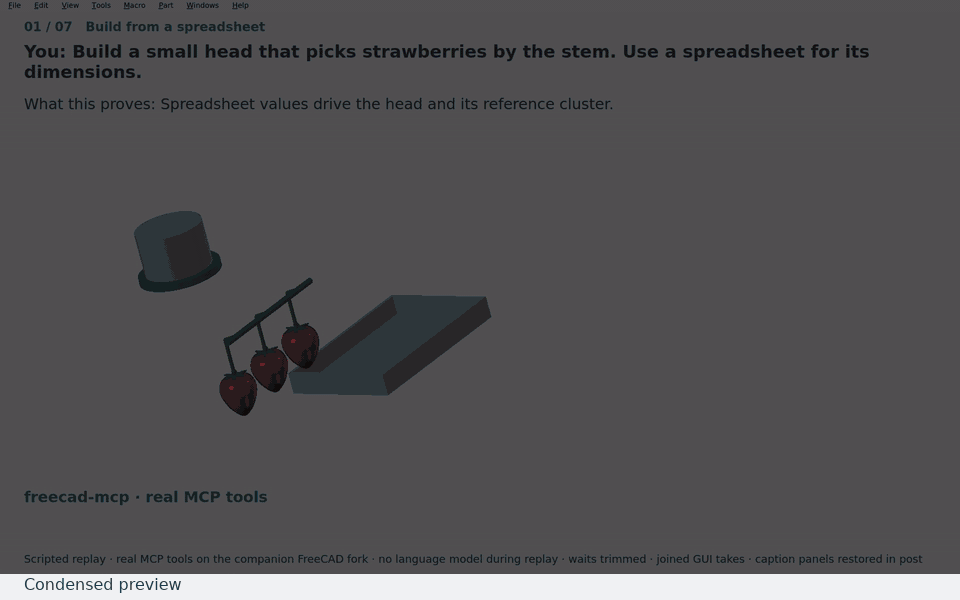

# Strawberry picking head

A small, spreadsheet-driven head holds a strawberry stem, cuts above the pad,
and withdraws the fruit. Ten printed parts carry two servo drives and a replaceable
39 mm blade. The native model includes the head, wrist reference, cluster and tray.

This is a **scripted replay**, with **real MCP tools on the companion FreeCAD fork**
and **no language model during replay**. It regenerates the retained parametric
checkpoint, changes/restores a jaw dimension and cluster spacing, then reveals the parts. GUI takes are joined at fixed poses and chapter boundaries. Idle waiting is trimmed; motion uses eased
spreadsheet poses. The relocated-tray transfer is an unvalidated placement preview.
freecad-mcp is its own project. The wrist reference and its pilot follow the head
in the native file; printed geometry and spreadsheet values retain the input design.
Caption/readback panels are restored in post to avoid GUI redraw damage; CAD
viewport pixels come from the real GUI capture.

**Forces from datasheets + FEM, not measured.** Nothing here reports a physical pick.

[Prompts shown](prompts.md) · [Per-check tool arguments and results](verification.json) ·
[Native parametric model](strawberry-head.FCStd) · [Head assembly STEP](assembly.step) ·
[Ten per-part STEP/STL pairs](parts/) · [Retained design notes and gaps](evidence/design-notes.md)

## Parts to make and buy

| Part | Count | Material / purchase note |
|---|---:|---|
| WristAdapter, DriveHousingReady, NoseFrameReady | 1 each | PLA structure |
| MovingJaw, BladeLever, BladeClamp | 1 each | PLA working parts |
| ClampLink, CutLink | 1 each | PLA links |
| FixedTPU, MovingTPU | 1 each | TPU replaceable pads; adhesive backing |
| Servo drive | 2 | 9 g allowance each; 176 N mm stall torque input; confirm real capability |
| Servo horn | 2 | 6 mm radius; compatible with the chosen servo |
| Replaceable steel blade | 1 | 39 mm envelope; confirm tang, thickness and edge position |
| Wrist flange screw | 4 | Model uses M6 clearance; match engagement to the actual wrist |
| Column bolt | 2 | Match modeled housing and wrist plate; heads seat underneath |
| Nose frame bolt and nut | 2 sets | Match the modeled bores |
| Servo tab M2 screw and captive nut | 4 sets | Two per servo |
| Jaw/cutter M3 pivot pin and locknut | 2 sets | Include modeled spacers/shim; check free movement |
| Link pin and retaining head | 4 sets | Two per link; verify retention |
| Blade-clamp M2 screw and nut | 2 sets | Seat the blade securely |
| Servo cable route | 2 | 2 mm envelope in 2.5 mm passages; strain relief still to specify |

Fastener solids are simplified envelopes, not thread models or a complete purchase
specification. Resolve lengths and retention against actual bought parts before assembly.
The exhaustive native physical-part list and attachment witnesses are in
[verification.json](verification.json) and the [design notes](evidence/design-notes.md).

## Print notes

Print the eight rigid parts in PLA and the two pads in TPU. Use the XY flat face for
all except NoseFrameReady, which uses the rear Y face; support its transverse bores.
Minimum specified printed walls are 2 mm, with about 2.4 mm principal bearing
ligaments. MovingJaw is 5.7 mm thick; BladeLever is 3 mm; BladeClamp is 2.4 mm.
These are design witnesses, not a global wall-thickness or overhang certificate.

The per-part files retain native assembly coordinates. Orient each flat face on the
bed in the slicer. The STL mesh deviation is 0.08 mm. Confirm bore fits, blade seating,
cable passages, nut access, pad adhesion and unobstructed travel before fitting a blade.
Use at least 2 mm walls and establish a practical infill in the slicer. The 40% PLA
mass convention is only an estimate; thin links and backings will be substantially solid.

## Results and their scope

Nominal fruit is 30 × 35 mm; the actual spline envelope is 30.198 × 30.198 × 35.180 mm.
The nominal 10 mm setting therefore gives about 9.802 mm actual fruit spacing.
The nose fix removes the unused lower cheek extensions and shortens the carrier by
4 mm. Bridge, anvil, pivot forks, drive geometry, pads and blade are retained.

| Check | Real MCP tool | Result |
|---|---|---|
| Printed native solids | `validate_geometry` | All ten valid and closed; one solid each |
| 15 approach | `measure_distance`, `common_volume_along_path` | ≥5.624 mm; common 0 mm³ |
| 15 clamp | `measure_distance`, `common_volume_along_path` | ≥4.073 mm; common 0 mm³ |
| 15 cut | `measure_distance`, `common_volume_along_path` | ≥4.073 mm; common 0 mm³ |
| 15 withdraw | `measure_distance`, `common_volume_along_path` | ≥4.073 mm; common 0 mm³ |
| 10 approach | `measure_distance`, `common_volume_along_path` | ≥0.693 mm; common 0 mm³ |
| 10 clamp | `measure_distance`, `common_volume_along_path` | ≥0.693 mm; common 0 mm³ |
| 10 cut | `measure_distance`, `common_volume_along_path` | ≥3.155 mm; common 0 mm³ |
| 10 withdraw | `measure_distance`, `common_volume_along_path` | ≥4.073 mm; common 0 mm³ |
| Approach and withdrawal, 15/10 mm | `common_volume_along_path` | 24 samples total; 0 mm³ common |
| Mechanism travel | `common_volume_along_path` | Eight poses; 0 mm³ unintended common; pin contacts excluded |
| Blade crosses the target stem | `common_volume_along_path` | 0 to 2.212 mm³ common during cut; crossing established |
| Original 10 mm nose | `measure_volume`, `execute_code` | Fruit clash 583.615 / 583.602 mm³; neighbouring stem 3.195 mm³ |
| Blade underside to moving pad | `execute_code` | 6.7 − 5.7 = 1.0 mm |
| Cable to housing and hardware | `common_volume_along_path` | 0 mm³ common |
| Force budget | `spreadsheet_get_cells`, `execute_code` | Minimum clamp 23.138 N / cut 33.417 N; need 10 / 15 N |
| Changed jaw FEM | `create_object`, `run_fem_analysis`, `execute_code` | 1.367 MPa; 0.016613 mm; yield SF 36.57; 367 nodes / 1063 elements |
| FEM matches changed jaw | `execute_code` | Source and current jaw volume match |
| Dimension binding | `audit_hardcoded_dimensions`, `execute_code` | 530 reported dimensional constraints expression-bound; 0 unbound findings |
| Mass estimate | `measure_volume`, `center_of_mass`, `spreadsheet_get_cells` | 83.84 g at retained fill convention; 130.38 g all-solid envelope |
| Parts and print exports | `execute_code`, `export_step`, `export_stl` | Native BOM; head assembly STEP; ten STEP/STL pairs |

The force input is 176 N mm stall torque, derated by 2 to 88 N mm. The ideal force
is working torque / 6 mm horn × 24 mm input arm / output arm (15 mm jaw, 10.5 mm
cutter). Ideal values are 23.467 N / 33.524 N. The reported minima include linkage
transmission correction sampled every 0.1°. **Forces from datasheets + FEM, not measured.**

FEM uses the actual changed jaw with the M3 bore fixed and 10 N on the pad backing:
isotropic PLA, E = 3500 MPa, Poisson ratio 0.36, yield = 50 MPa, first-order 1.5–3 mm
mesh. The stress view uses actual solver nodal values. The setup and results are
retained in [jaw-fem.FCStd](evidence/jaw-fem.FCStd) and [fem.json](evidence/fem.json).

A fresh coarse remesh during recording made 1,061 elements and gave 1.379 MPa
and 0.016680 mm. The video instead re-solves the retained 1,063-element mesh,
reproducing **1.3673729 MPa and 0.0166125 mm** through the actual solver. This keeps
the Stage 2a comparison fixed; the mesh variation is recorded in
[fem-remesh.json](evidence/fem-remesh.json). No convergence study is claimed.

## Gaps left

No physical grip or cutting test has been done. Discrete collision samples do not
prove continuous clearance. The final tray transfer lies outside the tested paths;
its animation does not simulate contact, dropping or gravity. Expression-driven
poses do not claim a solved dynamic assembly. Fruit envelopes omit real variation
and compliance, leaves, and dense plant clutter.

Coarse isotropic FEM does not establish layer strength, fatigue, blade sharpness or
mesh convergence. Establish the actual sliced mass, print orientation and fixture
strength. Cable strain relief, servo controller and rear connector remain outside the
modeled head boundary. No sensor, controller or guarded operating enclosure is implied.
Native solid checks and attachment distances do not prove joint strength or retention.

## Bench test plan

1. **Free travel:** assemble without the blade; move both drives through their full
   ranges by hand, then at low drive effort. Check pins, nuts, cables, pad alignment
   and the 1.0 mm blade-to-pad gap. Record any binding or loosening.
2. **10 N grip:** clamp a dummy stem and pull with a spring scale to 10 N. Record
   slipping, pad damage and servo behaviour over repeated holds.
3. **15 N cut:** measure cutting force on real stems with a spring scale, aiming to
   establish a 15 N requirement. Record stem size, blade condition and failed cuts.
4. **Dummy clusters:** test at 15 mm, then 10 mm nominal spacing. Complete approach,
   clamp, cut, withdrawal and tray transfer; watch the neighbouring fruit, calyces,
   stems and cables. Record bruising, contact and loss of fruit.
5. **Closer berries:** reduce the spacing gradually below 10 mm. Record the first
   contact or failed pick, including fruit dimensions and pose; use that measured
   limit to set the next design requirement.

The fixture, blade handling and drive effort must suit the bench setup. These steps
are a proposed test plan, not completed results.

## Reproduce

See [scripts/demo/README.md](../../scripts/demo/README.md). The replay uses one
bounded container and one GUI; there are no builds. Both overview and chapter GIFs
are condensed previews. The full local video is `demo-out/strawberry-picker.mp4`
and is deliberately excluded from the paths to stage.

Local video: **3:51.0**, seven chapters. GIFs: overview **2.36 MB**; motion **1.43 MB**; tight cluster **0.56 MB**; FEM **0.37 MB**. All GIFs are 960 px at 10 fps.
